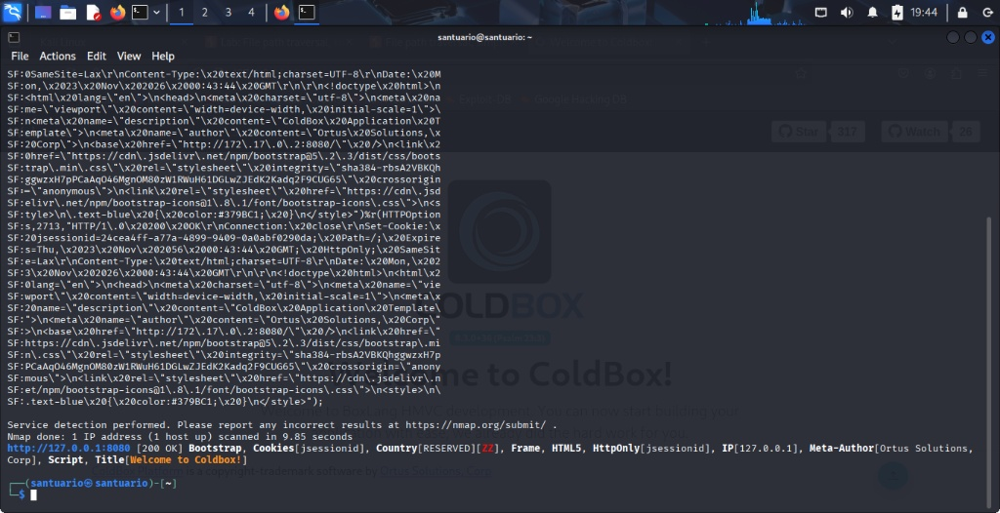
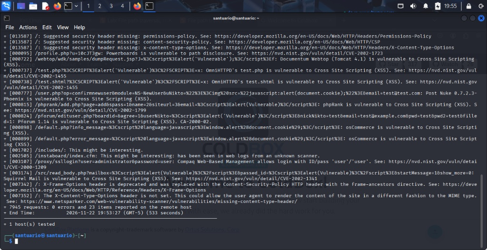
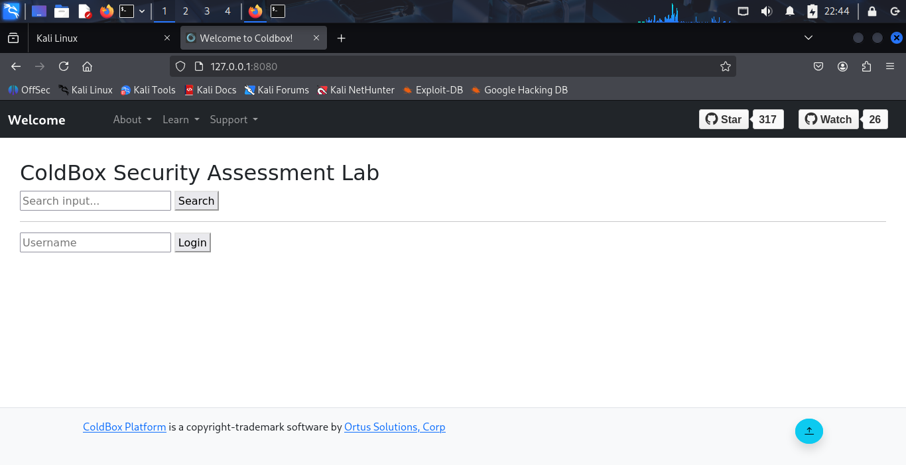
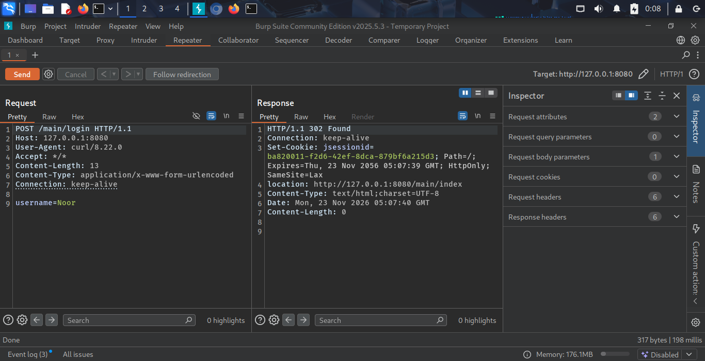
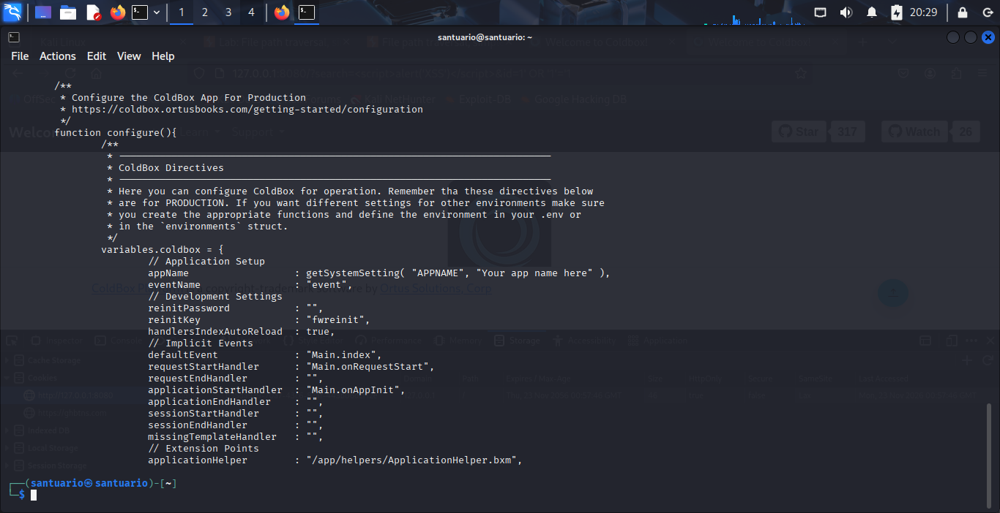
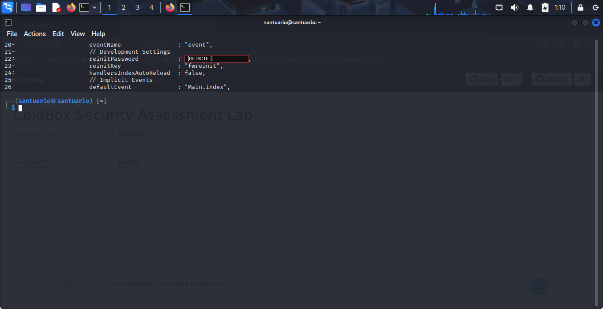
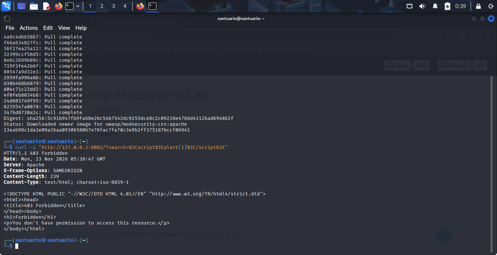
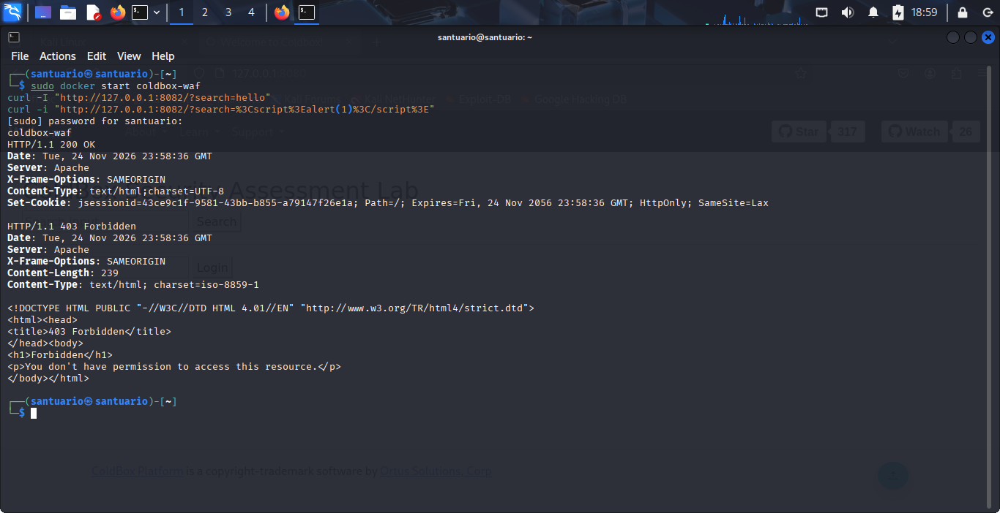

# ColdBox / BoxLang Security Assessment

Hi, I’m Noor. This is my first proper web application security assessment, which I completed during my cybersecurity internship.

I wanted to learn how security testing works in practice, so I built a small local lab instead of testing anything outside my own machine. The project uses a ColdBox application running on BoxLang in Docker. I tested it, reviewed the results, fixed a couple of configuration issues, and then added a web application firewall (WAF) to see how it handled malicious requests.

The full report is in the [`report/`](report/) folder. This README is a shorter overview of what I did and what I learned.

> **Note:** All testing was done locally on `127.0.0.1`. I did not test any real websites or systems that I do not own.

---

## What I used

- Kali Linux in VirtualBox
- Docker
- ColdBox 8.3.0+36 on BoxLang
- Nmap, WhatWeb, and Nikto
- Burp Suite Community and Firefox developer tools
- curl
- OWASP ModSecurity CRS v4.30.0

## How the lab works

I set up two routes to the application so I could compare them:

```text
Direct:   Me (Firefox / Burp / curl) ──► 127.0.0.1:8080 ──► ColdBox app
With WAF: Me (curl) ──► 127.0.0.1:8082 (ModSecurity WAF) ──► ColdBox app
```

Port `8080` goes directly to the app. Port `8082` sends the request through the WAF first.

---

## What I did

### 1. Set up the application

I started the ColdBox application in Docker and made sure it was running on port `8080`.


### 2. Reconnaissance

I used Nmap and WhatWeb to see what information the server was exposing. I found details such as the framework, page title, Bootstrap, and a session cookie called `jsessionid`.



### 3. Automated scanning

I ran Nikto, which sent around 7,945 requests and reported 23 items.

At first, that number looked worrying. After checking the results, I realised that most of them were false positives because Nikto was checking for PHP files, and this application is not built with PHP.

The useful findings were that three security headers were missing:

- Content-Security-Policy
- X-Content-Type-Options
- Permissions-Policy

This taught me that scanner results are a starting point, not proof that something is vulnerable.



### 4. Testing XSS and SQL injection

I created a simple page with a Search field and a Username field, then tried a basic XSS payload and a basic SQL injection string through the URL.

Nothing happened. The page uses `encodeForHTML()`, and there is no database connected to the application.

This does not mean the entire application is secure. It only means that this specific page handled the inputs I tested.




### 5. Checking the session cookie

I looked at the `jsessionid` cookie and found:

- `HttpOnly` was enabled, so JavaScript cannot read it.
- `SameSite=Lax` was enabled, which gives some protection against CSRF.
- The `Secure` flag was missing. This is expected in a local HTTP lab, but HTTPS would be needed in a real deployment.
- The cookie expires in 2056, which is 30 years away and seemed unusually long.

### 6. Testing the login flow

I used Burp Suite to send a login request with only a username. The server responded with a `302` redirect and issued a new cookie.

I did not send an old session cookie first, so I could not confirm whether the session ID changes after login. I added session rotation to my list of things to test next.



### 7. Reviewing the configuration

In `Coldbox.bx`, I found two settings that are useful during development but should not be left enabled in production:

```cfm
reinitPassword : "",             // Empty, so the framework can be reinitialized using ?fwreinit=1
handlersIndexAutoReload : true,  // Extra reloading that is not needed in production
```



### 8. Hardening the configuration

I set a strong `reinitPassword` and turned off `handlersIndexAutoReload`.

After that, visiting `?fwreinit=1` without the password returned the normal page. Since the page looked the same either way, I would improve this test next time by checking the container logs before and after the request.




### 9. Adding and testing the WAF

I placed OWASP ModSecurity CRS in front of the application on port `8082`.

I sent two requests:

- A normal request: `?search=hello`, which returned `200 OK`.
- An XSS request: `?search=<script>alert(1)</script>`, which returned `403 Forbidden`.




Then I checked the WAF logs to understand why the request was blocked. This was my favourite part of the project because I could see exactly which rules matched.

| Rule ID | What it detected | Severity | Points |
|---|---|---|---|
| 920350 | Host header is a numeric IP | Warning | 3 |
| 941100 | XSS (libinjection) | Critical | 5 |
| 941110 | Script tag | Critical | 5 |
| 941160 | HTML injection | Critical | 5 |
| 941390 | JavaScript method | Critical | 5 |
| **949110** | **Score of 23 exceeded the blocking threshold of 5** |  | **23** |


---

## Findings

| Finding | Risk | Status |
|---|---|---|
| Empty `reinitPassword` and auto-reload enabled | Medium | Fixed |
| Missing security headers | Low | Still open |
| Cookie missing `Secure` flag and expires in 2056 | Low | Still open; needs HTTPS |
| Nikto PHP path alerts | Info | False positives |
| Basic XSS and SQL injection on the test page | Info | No issue found on that page |
| WAF blocking XSS | N/A | Working; confirmed in logs |

## What I would improve next

- Add HTTPS and enable the `Secure` cookie flag.
- Add the missing security headers.
- Build a proper login flow and test whether the session ID changes after login.
- Use parameterized queries if a database is added.
- Test more pages, inputs, and payloads instead of focusing on one page.

## What I learned

- Automated tools are helpful, but their results need to be checked manually.
- Development settings should not be used in production.
- A WAF can block attacks, but the logs are important for understanding why.
- Being honest about the limits of a test is just as important as finding issues.

---

## Repository structure

```text
├── README.md          ← You are here
├── report/            ← Full PDF report
├── screenshots/       ← All 12 screenshots
├── commands/          ← Commands used during testing
└── config/            ← Configuration before and after hardening
```
