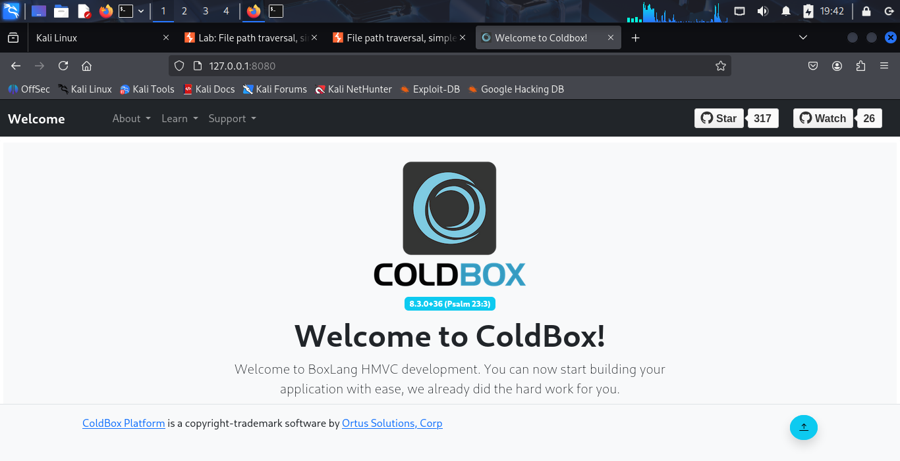
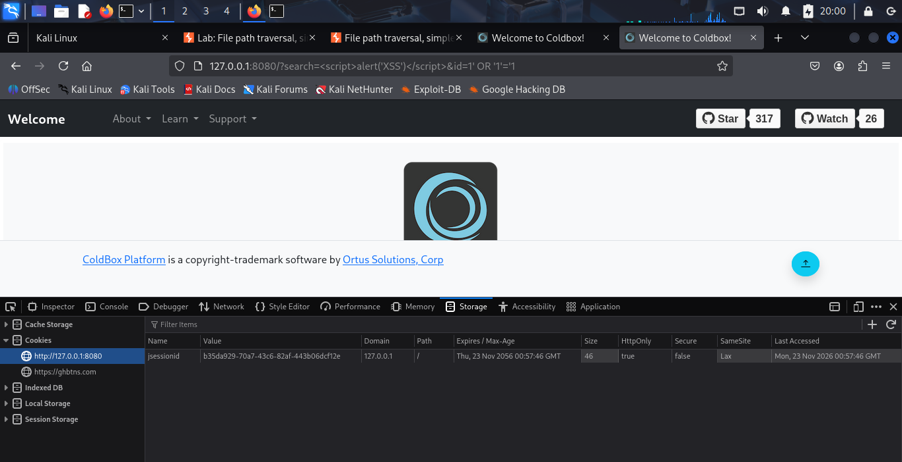
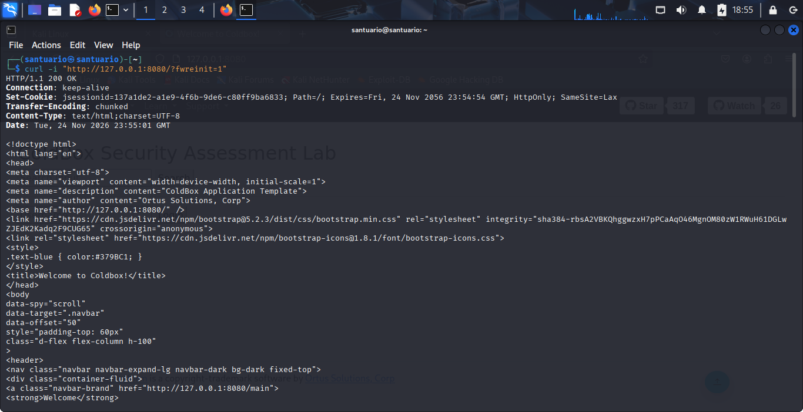
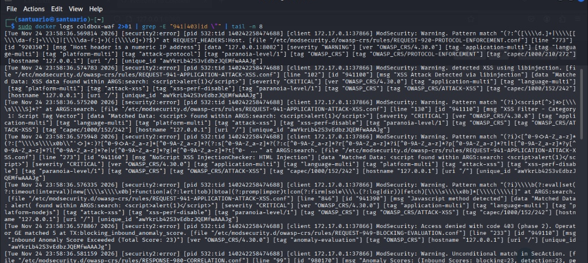

# My First Penetration Test: ColdBox / BoxLang Lab

Hi, I'm Noor. I built this project for my cybersecurity internship. It's my first real penetration test, so I kept everything in a small local lab where I could break things safely.

I set up a ColdBox web app (running on BoxLang) in Docker, tested it with common security tools, fixed some of the problems I found, and then put a web application firewall (WAF) in front of it to see if it would block attacks.

The full report is in [`report/`](report/). This page is the short version.

> **Note:** Everything here ran on my own machine (`127.0.0.1`). I did not test any real websites or other people's systems.

---

## What I used

- **Kali Linux** in VirtualBox (my testing machine)
- **Docker** to run the app and the WAF
- **ColdBox 8.3.0+36** on BoxLang (the target app)
- **Nmap**, **WhatWeb** and **Nikto** for scanning
- **Firefox** dev tools and **Burp Suite Community** (v2025.5.3) for looking at requests and cookies
- **curl** for quick tests from the terminal
- **OWASP ModSecurity CRS v4.30.0** as the WAF

## How my lab was set up

```
Direct:   Me (Firefox / Burp / curl) ──► 127.0.0.1:8080 ──► ColdBox app
With WAF: Me (curl) ──► 127.0.0.1:8082 (ModSecurity WAF) ──► ColdBox app
```

Port 8080 goes straight to the app. Port 8082 goes through the WAF first. I did it this way so I could compare the two.

---

## What I did, step by step

### 1. Got the app running
I started the ColdBox app in Docker and checked it loaded on port 8080.



### 2. Looked around (reconnaissance)
I ran Nmap and WhatWeb to see what the server tells people about itself. It showed the framework, the page title, Bootstrap, and a session cookie called `jsessionid`.


### 3. Ran an automated scan
Nikto sent about 7,945 requests and reported 23 items. I learned that a scanner result is not always a real problem:
- **Real:** 3 security headers were missing (Content-Security-Policy, X-Content-Type-Options, Permissions-Policy).
- **Not real:** the rest were checks for PHP pages like `/test.php`. My app isn't PHP, so I marked these as false positives.


### 4. Tried some basic attacks
I made a simple page with a Search box and a Username box. Then I tried a basic XSS payload and a basic SQL injection string in the URL. Nothing happened: no popup and no database error. That's because the page uses `encodeForHTML()`, and there's no database connected. So this only tells me this one page handled it, not that the whole app is safe.




### 5. Checked the session cookie
The `jsessionid` cookie had:
- `HttpOnly` ✔ (JavaScript can't read it)
- `SameSite=Lax` ✔ (some CSRF protection)
- `Secure` ✘ (expected, since my lab is plain HTTP, but this needs HTTPS in real life)
- An expiry date in **2056**, which is 30 years away. That surprised me.

### 6. Tested the login with Burp Suite
I sent a login request with only a username. The server replied with a `302` redirect and gave me a new cookie. I didn't send an old cookie first, so I couldn't prove the session ID changes after login (session rotation). I've listed that as something to test next.


### 7. Read the config file
In `Coldbox.bx` I found two settings that are fine for development but not for production:

```
reinitPassword : "",             // empty, so anyone can restart the framework with ?fwreinit=1
handlersIndexAutoReload : true,  // extra reloading that isn't needed in production
```


### 8. Fixed the config
I set a strong `reinitPassword` (hidden in the screenshot) and turned `handlersIndexAutoReload` off.


After that, `?fwreinit=1` without the password just returned the normal page. A normal page looks the same either way, though, so next time I'd also compare the container logs before and after to prove it.



### 9. Added a WAF and tested it
I put OWASP ModSecurity CRS in front of the app on port 8082. Then I sent:
- a normal request (`?search=hello`), which got **200 OK** and passed through
- an XSS request (`?search=<script>alert(1)</script>`, URL-encoded), which got **403 Forbidden** and was blocked


Then I checked the WAF logs to see why it blocked the request. This was my favourite part:

| Rule ID | What it detected | Severity | Points |
|---|---|---|---|
| 920350 | Host header is a numeric IP | Warning | 3 |
| 941100 | XSS (libinjection) | Critical | 5 |
| 941110 | Script tag | Critical | 5 |
| 941160 | HTML injection | Critical | 5 |
| 941390 | JavaScript method | Critical | 5 |
| **949110** | **Score 23 is over the limit of 5, so the request is blocked** | | **23** |



---

## Summary of findings

| Finding | Risk | Status |
|---|---|---|
| Empty `reinitPassword` + auto-reload on | Medium | Fixed |
| Missing security headers (CSP, nosniff, Permissions-Policy) | Low | Still open |
| Cookie without `Secure` flag, 2056 expiry | Low | Still open (needs HTTPS) |
| Nikto PHP path alerts | Info | False positives |
| Basic XSS / SQLi on test page | Info | Nothing found on that page |
| WAF blocking XSS | N/A (control) | Working, confirmed in logs |

## What I'd do next
- Add HTTPS and turn on the `Secure` cookie flag
- Add the missing security headers
- Build a real login with a password and test that the session ID changes after logging in
- Use parameterized queries if a database is added
- Test more pages and payloads, not just one

## What I learned
- Scanner results need to be checked by hand. Most of my 23 Nikto items weren't real.
- Default settings are made for developers, not for production.
- A WAF is useful, but the logs are what show you why it blocked something.
- It's important to be honest about what a test does and doesn't prove.

---

## Files in this repo

```
├── README.md          ← you are here
├── report/            ← full PDF report
├── screenshots/       ← all 12 screenshots
├── commands/          ← every command I ran
└── config/            ← the config settings before and after
```
